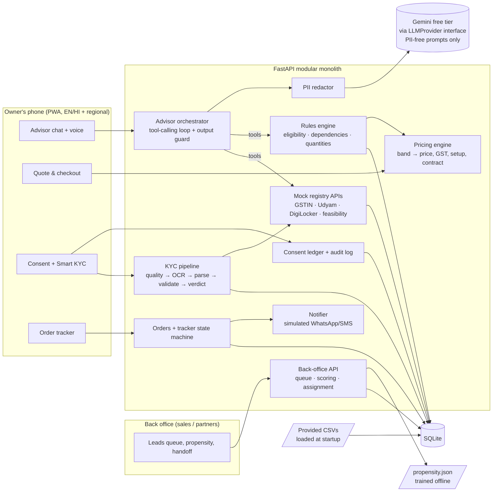

# Udyam Digital: solution architecture

> Airtel SYNC 2026, Digital Track (case: "Project Udyam Digital", Accel Telecom / Accel Business).
> Status: design frozen for build, **no code written yet**. Reasoning for each choice is in [DECISIONS.md](DECISIONS.md).

## 1. What we are building

A phone-first web app (PWA) where a small-business owner, in their own language:

1. **Advisor**: chats (typing or voice) with a GenAI advisor that asks about the business and recommends a bundle, explaining why in plain words.
2. **Quote and checkout**: sees one monthly price, toggles add-ons, picks a contract length, accepts.
3. **Smart KYC**: gives consent, types a GSTIN (we prefill from the registry), uploads 4 document photos, and gets a verdict in seconds with a specific fix for anything wrong.
4. **Tracker**: follows the order through install and activation instead of calling support.

Plus a **back office** for sales and partners: leads the advisor could not close, a propensity-ranked call list, and handoff with full context.

## 2. The rule that shapes everything

**The LLM talks; deterministic code decides.**

The LLM gathers facts, calls tools, and explains results. It never chooses a product, a quantity, a price, or a KYC verdict. Those come from a rules engine built on `product_catalogue.csv` and from validators built on the mock registries. Reasons:

- Judges run 15 live advisor scenarios. An LLM that picks products will sooner or later offer a 1 Gbps line in a tier-2 city or a WhatsApp API to a business without a GSTIN. The data shows human sales already did this: **56 of 368 activated bundles break the catalogue's own rules**, 22 of them GSTIN-only products sold without an active GSTIN.
- Prices must be reproducible and auditable, the same answer every time.
- The LLM can then be swapped, or fail, without breaking the journey (scripted fallback, see section 6).

## 3. Component diagram



Images for the deck are exported from this diagram into `deliverables/` (see [DELIVERABLES.md](DELIVERABLES.md)).

## 4. Main data flows

### 4.1 Advisor to quote

The LLM is Gemini on the free tier, so the flow is built around **one LLM call per normal turn** (structured JSON output, no tool loop) and one extra call on the recommendation turn. The server, not the LLM, decides when to look things up and when to recommend. Details in [DECISIONS.md D6a](DECISIONS.md).

```mermaid
sequenceDiagram
  participant O as Owner
  participant A as Advisor orchestrator
  participant L as Gemini (free tier)
  participant R as Rules + pricing
  participant G as GSTIN registry
  O->>A: "Meri dental clinic hai Pune mein, 12 log"
  A->>A: redact PII, add profile so far + missing slots
  A->>L: call 1 (JSON schema)
  L-->>A: {slots:{type:dental clinic, city:Pune, employees:12}, intent:ask, reply:"GSTIN hai?", language:hi}
  A->>A: merge slots; derive segment, tier, state
  A-->>O: reply (in Hindi)
  O->>A: "Haan, 27ABCXX..."
  A->>A: regex pulls GSTIN out BEFORE redaction
  A->>G: lookup_gstin (server side, never sent to LLM)
  G-->>A: Active, Proprietorship, Maharashtra
  A->>L: call 2, GSTIN replaced by [GSTIN_OK]
  L-->>A: {slots:{...}, intent:recommend}
  A->>R: complete profile
  R-->>A: bundle + reason codes + price breakdown
  A->>L: call 3: reason codes → explanation in owner's language, no prices
  L-->>A: plain-language explanation
  A->>A: guard: products named must be in the bundle, no rupee amounts
  A-->>O: deterministic recommendation card + explanation + "See quote"
```

If any call fails or is rate-limited: next model in the chain → scripted advisor for that turn. If call 3 fails: templated EN/HI explanations of the reason codes.

### 4.2 Smart KYC

```
consent (per purpose, versioned) ─► GSTIN typed or OCR'd ─► registry lookup (status, legal name, state)
        │
        └► 4 uploads (GST cert, Udyam cert, signatory ID, address proof), or DigiLocker (mock)
              │ in memory only
              ▼
        quality gate: blur score, skew, resolution  ──fail──► "retake" with a specific hint
              ▼
        preprocess: red-channel watermark removal, deskew
              ▼
        local OCR (no image leaves our server)
              ▼
        label-anchored field parser (templates are "Label: value")
              ▼
        validators:
          format     GSTIN structure + mod-36 check digit (4th char X allowed), Udyam format,
                     checksum-guided repair of OCR confusions (O/0, I/1, S/5, B/8)
          registry   GSTIN Active? Udyam exists? names, constitution, state agree?
          cross-doc  names agree (fuzzy), address agrees, GSTIN state code = address state
          freshness  address proof <= 90 days before 2026-07-15, ID valid on that date
          complete   all 4 documents present (or registry match accepted in place of Udyam cert)
              ▼
        verdict: approved | needs_action (owner can fix in app) | review (specialist) | blocked
              ▼
        image bytes dropped; masked extracted fields + check results + audit event stored
```

Identity is matched **by identifier, never by name**. The registry has many businesses with the same trade name (for example six "Vindhya Tours & Travels" entries in different states).

### 4.3 Order and tracker

State machine per order, with per-product line items:

`QUOTE_ACCEPTED → KYC_VERIFIED → FEASIBILITY_OK → INSTALL_SCHEDULED → INSTALLED → ACTIVATED`
(side states: `NEEDS_ACTION`, `FEASIBILITY_FAILED → offer 5G AirFiber P04`, `CANCELLED`)

- ETA per line item = KYC date + `typical_install_days`; order ETA = the slowest item. Mobile lines (1 day) activate first, so the owner gets something working on day 1.
- Every transition sends a simulated WhatsApp/SMS notification and appears on the tracker timeline. That removes the reason for status calls.
- The back office has a demo clock to move time forward during the video.

### 4.4 Back office

- Queue of leads the advisor could not close: handed off, abandoned at quote, KYC `needs_action`/`review`, feasibility failed. Each comes with the conversation summary and the reason.
- Every lead (the 5,000 historical ones plus new sessions) has a **propensity score** and an expected value (`p(activate) × expected monthly value`).
- Assignment rules: multi-site and manufacturers go to field sales (assisted, high value); micro retail goes to a channel partner for install and assisted KYC; professional offices are self-serve with a callback if they get stuck. Partners keep attribution through referral codes and QR links, so digital sales do not cut them out.

## 5. Module layout (planned)

```
backend/
  app/
    main.py            FastAPI app, serves the built frontend too (one deployable)
    data/              CSV → SQLite loader, repositories
    catalogue/         product model, eligibility rules, dependency resolver, quantity rules
    pricing/           band → price, contract terms, GST, setup fees, savings vs current spend
    advisor/           orchestrator, tool schemas, prompts, guard, scripted fallback, i18n
    llm/               provider interface, Gemini provider (google-genai), model fallback chain,
                       rate limiter, dev response cache, fake provider for tests
    registry/          mock GSTIN, Udyam, DigiLocker, fibre feasibility
    kyc/               quality, preprocess, ocr, parsers, validators, verdict
    privacy/           consent ledger, masking, redaction, retention, audit log
    orders/            order model, state machine, ETA, notifier
    backoffice/        queues, scoring, assignment
  tests/               unit tests (GSTIN checksum, rules, pricing, KYC answer key)
frontend/              React + Vite + TypeScript + Tailwind, react-i18next
ml/                    propensity training notebook/script → backend/app/backoffice/propensity.json
evals/                 advisor scenarios (our stand-in for the judges' 15) + runner
data/raw/              provided synthetic dataset (unchanged)
docs/                  this file, decisions, deliverables, data insights, competitor scan
deliverables/          deck, privacy note, diagram exports, demo video link
```

## 6. Failure modes we design for

| Failure | Behaviour |
|---|---|
| Gemini free tier returns 429/503, is slow, or is down | Client-side rate limiter keeps us under the per-model RPM; on error, move down the model chain (Flash-Lite → Flash), then the **scripted advisor** (rule-based slot filling in EN/HI/Hinglish) continues from the same slots, so the demo never stalls |
| Daily quota used up | Same scripted path; demo key kept separate from the dev key; video recorded right after the 1:30 PM IST reset |
| LLM names a product not in the bundle, or states a price | Guard rejects the explanation and falls back to the templated EN/HI explanation; the recommendation card itself never comes from the LLM |
| OCR misreads a GSTIN | Checksum-guided repair; accept a repair only if the registry name matches |
| Blurry or tilted photo | Quality gate asks for a retake (or a DigiLocker fetch) before OCR runs |
| Fibre not feasible at address | Tracker offers 5G AirFiber (P04, 2-day install) and recalculates the quote |
| Owner abandons | Lead lands in the back-office queue with context; partner or field sales can resume from the same step |

## 7. Deployment

- One Docker image: FastAPI serves the API and the built frontend; SQLite file inside; CSVs baked in.
- Hosted on a free tier (Render or Railway; pick on day 1) so judges can open a link. The demo video is recorded against a local run in case hosting is flaky.
- Secrets only from environment variables; `.env` is git-ignored.
