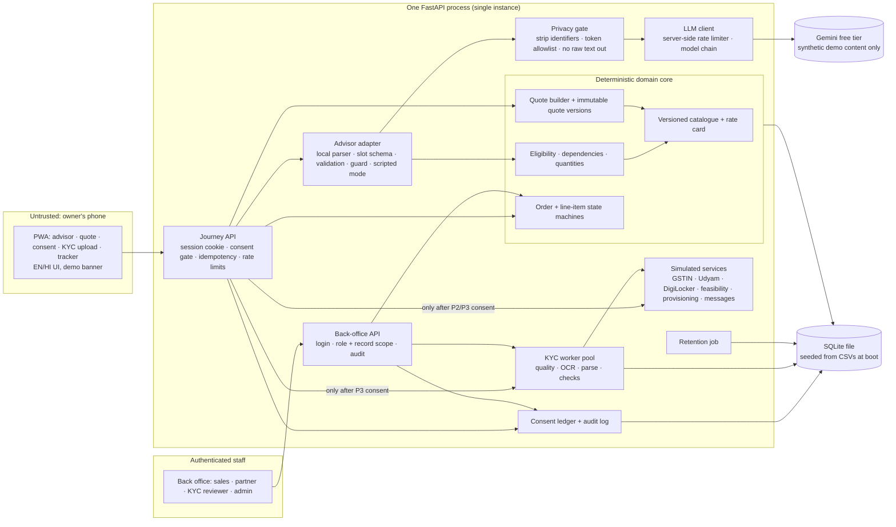
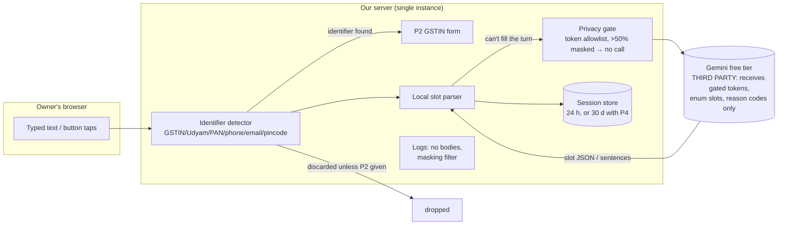

# Udyam Digital: solution architecture

> Submitted to **Airtel SYNC 2026, Digital Track** (Unstop). The case document is titled **"Project Udyam Digital", YTL Hackathon 2026, Enterprise Track A** (fictional operator Accel Telecom / Accel Business). We use both names this way everywhere.
> Status: design reviewed over five rounds ([review.md](../review.md)). **Status (06 Nov 2026): specification plus a working prototype.** The backend, the PWA and a CI workflow exist on branch `build/foundation` (see the README status table). A control counts as working only where the [controls register](POLICIES.md#15-controls-register) says so, with its evidence; everything else here is still a spec.

## 1. What we are building, and what we are not claiming

A phone-first web app (PWA) where a small-business owner can:

1. **Advisor:** answer a few questions (typed or buttons; voice is cut, see POLICIES §5.3) and get a bundle from the catalogue with a reason for each item.
2. **Quote:** see one reproducible price: monthly recurring, one-time charges, an illustrative tax line, first payment, and each item's commitment term. Add-ons are toggles.
3. **KYC:** choose which consents to give, then upload 4 documents and get **automated consistency checks** with a specific fix for anything wrong.
4. **Tracker:** follow order and line-item status instead of calling support.

Plus a **back office** where sales, partners and KYC reviewers see only the leads and cases they are allowed to see.

What this prototype **is not**: legally compliant (it is designed around the case's DPDP principles, with synthetic data and mock services); identity verification (KYC results are consistency checks and do not detect tampering); an operational commitment (ETAs are indicative, installs and messages are simulated). [POLICIES.md §12](POLICIES.md#12-labelling-at-a-glance) defines how each of these is labelled on screen.

## 2. The rule that shapes everything

**The model talks; deterministic code decides.**

The LLM proposes slot values and writes short explanations. It never decides products, quantities, prices, consent, KYC outcomes or order transitions, and nothing it returns is trusted without validation. Reason: in the supplied data, **56 of 368 activated bundles break the catalogue's own rules** (24 on city tier, 21 GSTIN-only products without an active GSTIN, 9 missing dependencies, 8 below minimum staff). A rules engine will check every bundle; planned tests on the worked quotes and negative cases will show whether it does.

## 3. Components and trust boundaries



Trust boundaries:
- **Owner → Journey API:** everything from the phone is untrusted. The server validates every field, owns the session, and checks that a session can only touch its own quote, order and KYC case.
- **Server → LLM (outbound):** nothing leaves except the privacy gate's output: gated tokens from an allowlisted vocabulary, enum slots and reason codes. Raw owner text, names, addresses and identifiers never leave ([POLICIES.md §5.2](POLICIES.md#52-the-privacy-gate-runs-before-every-outbound-llm-request)).
- **LLM → advisor adapter (inbound):** LLM output is untrusted input. It may only fill a fixed slot schema and keyed explanation sentences. The adapter validates both, and the server renders every product, quantity and price from IDs.
- **Consent gate:** registry lookups, KYC processing, saving a session and sharing with staff are each gated by their own recorded purpose ([POLICIES.md §2](POLICIES.md#2-consent-and-purposes)).
- **Staff → Back-office API:** separate login and roles; every query is filtered by role **and** by record scope (a partner sees only leads that named that partner).

## 4. Main data flows

### 4.1 Advisor to quote

Gemini is on the free tier, so the flow is built around a small, predictable call budget ([DECISIONS.md D6a](DECISIONS.md)).

```mermaid
sequenceDiagram
  participant O as Owner
  participant J as Journey API
  participant A as Advisor adapter
  participant L as Gemini
  participant R as Rules + quote
  O->>J: starts; P1 notice shown
  O->>J: "Meri dental clinic hai Pune mein, 12 log"
  J->>A: message + slots so far
  A->>A: local parser: type=dental clinic, city=Pune, employees=12 → enough, NO LLM call
  A-->>O: next question from a template in Hindi
  O->>J: "Do branch hain, ek Kothrud wali Mrs. Joshi ke ghar ke paas"
  A->>A: local parser unsure (sites?) → privacy gate
  A->>A: gate: "do branch hain ek [?] wali [?] [?] ke [?] ke paas" (4 of 11 masked) + slots as enums
  A->>L: call 1: extract slots (JSON schema), gated text only
  L-->>A: {sites:2, intent:ask}
  A->>A: validate each slot (enums, ranges)
  O->>J: "GST hai"
  A->>A: local parser: has_gstin=true, no LLM call
  J-->>O: summary card: Dental clinic · Pune · 12 · 2 sites · has GSTIN (editable)
  O->>J: confirms card (optional: taps "check my GSTIN", P2 consent form)
  J->>R: confirmed profile
  R-->>J: bundle + reason codes + exclusions + quote v1
  A->>L: call 2: one sentence per reason code (codes + coarse slots only, no owner text)
  L-->>A: {SEGMENT_BASE:"...", NEED_SECURITY:"..."}
  A->>A: guard (keys, length, no numbers/₹/%/SLA, no other product names)
  J-->>O: card rendered from IDs + sentences (or EN/HI templates if guard fails)
```

Budget per session: **at most one call per owner turn, and only when the local parser can't fill the turn, plus one explanation call**; typically 1–4 calls; hard cap 12, after which the session continues in scripted mode. If more than half of a message's tokens are masked by the gate, no call is made and the turn goes to buttons. On `429`: no retry on that model, move to the next model in the chain. On `5xx` or a 10-second timeout: one retry after 1 s, then the next model. When every model fails: scripted mode for that turn. The limiter runs **in the server process** (single instance), keyed to the project's per-model quotas.

**Scripted mode** is a complete path, not a degraded one: the same questions as buttons and short replies with EN/HI labels, plus EN/HI/Hinglish free-text parsing. It is also the **zero-quota demo path** (`ADVISOR_MODE=scripted`, switchable from the admin screen).

### 4.2 GSTIN lookup (eligibility)

```
owner taps "Check my GSTIN" ─► P2 notice + consent ─► GSTIN form field (not chat)
  ─► format + check digit ─► simulated registry ─► active | cancelled | suspended | not_found | unavailable
  ─► prefill (name, constitution, state) shown with "from mock registry, as of 15 Jul 2026"
```
A GSTIN typed into chat before consent is caught server-side, not sent to the LLM, not looked up and not stored. The owner sees the consent card instead.

### 4.3 KYC

```
P3 consent ─► 4 uploads (JPEG/PNG ≤ 8 MB each) or "Fetch from DigiLocker (simulated)"
  ─► bytes kept in memory, decoded, downscaled to ≤ 2000 px, never written to disk
  ─► bounded worker pool (2 workers, 20 s timeout, queue of 4; beyond that "busy, try again")
  ─► quality gate (blur, skew, size) ──fail──► owner_action_needed + hint
  ─► preprocess (red-channel watermark removal, deskew) ─► local OCR ─► label-anchored parser
  ─► identifier repair candidates shown to the owner to confirm (raw value + candidate + confirmation stored)
  ─► checks: format · registry status · cross-document names/address · state code · freshness vs business_as_of · completeness · signatory
  ─► applicant result: checks_passed | owner_action_needed | manual_review
  ─► line eligibility per item: eligible | excluded(reason), e.g. GSTIN-only lines with a Cancelled GSTIN
  ─► image bytes dropped; masked/encrypted fields + check results + audit events stored
```
Records are linked **by identifier**; names and addresses are consistency checks only and can lower an outcome but never raise it. Definitions and thresholds: [POLICIES.md §9](POLICIES.md#9-kyc-outcomes).

### 4.4 Orders and tracker

Separate order-level and line-item state machines, immutable accepted quote versions, idempotent commands, and a transition table with actor and trigger ([POLICIES.md §10](POLICIES.md#10-orders-and-tracker-simulated)). If some lines are excluded at KYC, the order waits in `ON_HOLD (BUNDLE_CHANGE_NEEDED)` until the owner accepts a new quote version without them; the KYC result is reused, not redone (worked example in POLICIES §10). Mobile lines can go active once the order is `KYC_OK`, independent of fibre. A feasibility failure offers a substitute only as a new quote version that the owner must accept. ETAs say "about N days (indicative)". Messages sit in an in-app inbox labelled "Simulated message, not sent".

### 4.5 Back office

- **Queue:** leads with P5 consent that the advisor could not close (handoff asked, abandoned at quote, KYC on hold, feasibility failed), each with a short summary and the reason. A partner sees only leads that named that partner.
- **Ranking:** starts as a **transparent rules-based queue** (GSTIN active, segment, stage reached, days waiting). The propensity model replaces it only if it beats that baseline on a time-based holdout ([DECISIONS.md D12](DECISIONS.md)). Ranking value is labelled **expected revenue**, not margin, because the data has no margin.
- **Two separate lists:** historical synthetic leads (scored offline in batch) and live prototype leads (scored at handoff). They are never mixed.
- **Referral credit is not access:** a referral code credits a partner; only P5 naming that partner lets it see the application ([POLICIES.md §11](POLICIES.md#11-back-office-roles-and-scope)).

### 4.6 Privacy data flow: owner input (planned controls)

Where owner input can go, and what is specified to stop it. Third-party services sit outside the server box. **Voice is cut** (POLICIES §5.3), so the only input path is typed text and button taps; the browser has no speech service in the flow.



- An identifier typed into chat is caught before anything else runs; it is used only through the P2 form, never sent to the LLM.
- Gemini receives only the gate's output. Raw text stays in the session store and is deleted with the session.
- All of this is the **specified** flow. It counts as working only once the privacy-gate report for the demo commit shows 0 leaks (POLICIES §15); until then the Gemini key is not set on the demo build.

## 5. Module layout (planned)

```
backend/
  app/
    main.py            FastAPI app; serves the built frontend (one deployable)
    config/            settings, policy.yaml (freshness days, thresholds, retention), clock
    data/              CSV → SQLite seed, repositories
    catalogue/         versioned catalogue + rate card, eligibility, dependencies, quantities
    pricing/           quote builder, GST, quote versions
    advisor/           local slot parser + lexicon, slot schema, validators, adapter, guard, scripted mode, templates (EN/HI)
    privacy_gate/      identifier stripping, token allowlist vocabulary, masking threshold, red-team test set
    llm/               Gemini provider (google-genai), server-side limiter, model chain, dev cache, fake provider
    registry/          simulated GSTIN, Udyam, DigiLocker, feasibility, provisioning
    kyc/               worker pool, quality, preprocess, OCR, parsers, checks, outcomes
    privacy/           consent ledger, masking, encryption, audit log, retention job
    orders/            state machines, transition table, ETA, simulated messages
    backoffice/        auth, roles and scope, queue, assignment, attribution, scoring
    security/          server-side sessions, CSRF + Origin checks, Argon2id, Fernet key ring, idempotency, rate and upload limits
  tests/               rules, pricing (WORKED_QUOTES.md cases), GSTIN, KYC answer key, state machines (incl. the
                       mixed-order example), privacy-gate red-team set, consent/retention, role scope via direct API calls, CSRF
frontend/              React + Vite + TypeScript + Tailwind, react-i18next
ml/                    data-insight script, propensity training + baseline comparison → propensity.json
evals/                 advisor scenarios + runner (fake provider by default, capped --live)
data/raw/              supplied synthetic dataset (unchanged)
docs/                  architecture, decisions, policies, worked quotes, data insights, deliverables
deliverables/          deck, privacy note, diagram exports, demo video link
```

## 6. Failure modes

| Failure | Behaviour |
|---|---|
| Gemini 429 / 5xx / timeout | Server-side limiter, model chain, then scripted mode for that turn ([§4.1](#41-advisor-to-quote)) |
| No quota at all from the first minute | `ADVISOR_MODE=scripted`: the full journey runs on buttons and EN/HI/Hinglish parsing; rehearsed as the backup demo |
| Owner writes in Tamil, Marathi, Kannada, Punjabi or Bengali | On the free tier the gate masks most of those words, so the turn goes to EN/HI buttons with a callback offer (needs P5). Only EN/HI is promised; other languages need the `approved` LLM profile |
| Owner volunteers a name, address or other personal detail in chat | The gate's token allowlist masks it; it never reaches Gemini; it is deleted with the session |
| Cancelled/Suspended GSTIN with GSTIN-only items in the order | Those lines `EXCLUDED`; order `ON_HOLD (BUNDLE_CHANGE_NEEDED)`; one-tap new quote version without them; KYC result reused |
| Explanation fails the guard | Templated EN/HI sentence for each reason code; the card is unaffected |
| OCR misreads an identifier | Repair candidate shown to the owner; never auto-accepted |
| Blurry or tilted photo | `owner_action_needed` with a retake hint, or DigiLocker (simulated) |
| Registry outage (simulated toggle) | Quote continues; KYC waits; nothing is unlocked |
| Fibre not feasible (simulated) | Order `ON_HOLD`; substitute offered as a new quote version |
| Many uploads at once | Bounded worker pool; "busy, try again" instead of blocking the API |
| Duplicate taps or retries | Idempotency keys on accept, upload, KYC submit and transitions |
| Host restarts | Demo data re-seeded from CSVs; sessions lost; stated up front |

## 7. Deployment

- **Decision:** one Docker image (FastAPI serves the API and the built PWA), **single instance**, SQLite inside the container, re-seeded from the CSVs at every boot. No horizontal scaling, so the limiter, sessions and worker pool live in one process.
- **Hosting:** Render free web service, chosen because it builds from a Dockerfile in a GitHub repo. Its free disk is **ephemeral** and the service sleeps when idle. That is acceptable only because the hosted copy is a **demo of synthetic data that resets on restart**, labelled as such. We wake it before any judging session. Day-1 task: deploy the empty skeleton and confirm these behaviours.
- **The live judge demo and the video run locally** on a laptop (same image), so a host restart cannot lose state mid-demo.
- **Production path (deck only):** managed Postgres, no document storage needed (images are not kept), a shared rate limiter, multiple instances, a managed key store for the KYC field key, and an LLM in the `approved` profile only after the launch gate in [POLICIES.md §5.1](POLICIES.md#51-two-llm-profiles) is signed off. A paid service is required for that, but it is not sufficient on its own.
- Secrets come only from environment variables; `.env` is git-ignored.
